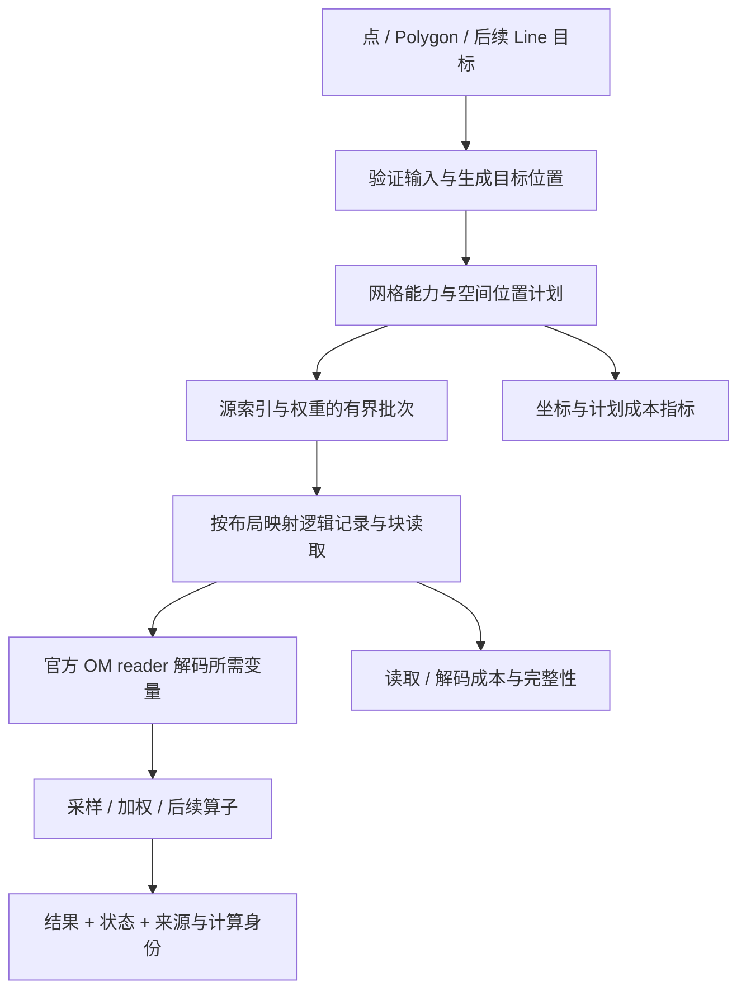

# 空间采样与区域计算设计提案

状态：设计提案，未实现；首版范围已形成 [006 最近邻采样规格](../../specs/006-region-nearest-sampling/spec.md)，其中的规范要求优先于本提案，插值和区域权重仍为后续方向。用户已确定在现有 `read_om_regions` 内以 `method` 选择计算方式，不新增采样函数；本文件完善计算语义、接口边界和实施顺序，不把草案参数当成当前可调用 API。调研日期：2026-10-14 UTC。关联：[生态调研](../research/2026-10-14-spatial-computation-ecosystem.md)、[005 spec](../../specs/005-polygon-region-statistics/spec.md)、[当前架构](../architecture.md)。

## 1. 问题与设计结论

东城区在本地区界中的经度范围为 116.380590°–116.450939°，处于 GFS 0.25° 的 116.25°、116.50° 两列采样点之间。`read_om_regions` 与独立 `read_om + ST_Covers` 均为零行；18 个北京区界 feature 的源点集合对照一致。它符合 005 FR-005/010，但不能满足“小行政区也取得可解释气象值”的需求。

在同一个区域入口内区分三类计算语义：

1. **原始区域选点**：现有 `read_om_regions` 返回面覆盖的真实源记录。统计由 SQL 等权聚合。
2. **目标位置采样**：在 `read_om_regions` 内选择 `method='nearest'` 或后续 `bilinear`；内部点采样核心可复用，不要求用户选择另一个函数。
3. **区域覆盖计算**：在有明确支持单元和变量含义时输出交叠权重，再由 SQL 计算面积平均或面积积分。

长期采用“目标 → 位置/权重计划 → 受限源读取 → 计算 → 结果与证据”的流程。复用网格、布局、官方 reader 和 HTTPFS，计算核心独立于原始 scanner 的语义。先完成解决小区域问题的最近邻，不先建立通用算子 DSL 或新的 datacube 类型。

## 2. 术语与可比较性

| 术语 | 本提案含义 |
| --- | --- |
| 源采样点 | 文件中已有的网格位置；坐标和原始记录身份可追溯 |
| 目标位置 | 调用者希望估计值的位置，可能不是源采样点 |
| 区域代表位置 | 从 polygon 计算的面内点，或调用者提供的业务位置 |
| stencil | 一个目标涉及的有限源点和空间权重；nearest 为 1 点，bilinear 最多 4 点 |
| 支持单元 | 声明某个源值代表的空间范围，可能是提供的边界或显式构造的范围 |
| 几何覆盖率 | 区域与网格支持范围的交叠面积 / 区域面积 |
| 有效覆盖率 | 对当前变量和非空间轴组合，有效值的交叠面积 / 区域面积 |
| 计算方法身份 | 算法版本、距离/面积模型、支持单元构造、缺测和边界策略的规范身份 |

代表点值、区内点平均、支持单元面积平均是不同结果。使用 `method` 不能省略“在什么对象上计算”。同一张结果表应能通过方法身份判断两行是否可比较。

## 3. SQL 接口选择

### 3.1 公共入口：在 read_om_regions 中选择 method

用户按查询目的选择入口：

| 查询目的 | 使用方式 |
| --- | --- |
| 查看文件、读取网格数据，或按经纬度范围筛选 | `read_om`；`WHERE lat/lon` 是矩形坐标筛选，不执行 polygon 判定 |
| 已有行政区/流域等 polygon，希望按区域读取或计算 | `read_om_regions`；用 `method` 选择区内原始点、最近邻或插值 |

`read_om_regions` 可以理解为“给 read_om 加上区域输入与处理方式”，共同支持 domain、variable、时间及其它轴配置。现有正式名字为复数 `read_om_regions`，沿用它，不再增加单数别名或采样函数。内部模块分离不要求公共函数也分离。

以下前两个例子是当前行为；`method` 和最近邻例子为待实现设计：

```sql
-- 查看或筛选原始网格。
SELECT lat, lon, temperature_80m
FROM read_om('snapshot.om', domain := 'ncep_gfs025',
             variable := 'temperature_80m')
WHERE lat BETWEEN 39.5 AND 40.5 AND lon BETWEEN 116 AND 117;

-- 按区域读取原始点；省略 method 保持今天的行为。
SELECT region_id, count(*) AS source_samples, avg(temperature_80m)
FROM read_om_regions(
  'snapshot.om', domain := 'ncep_gfs025', variable := 'temperature_80m',
  regions := getvariable('districts'), region_crs := 'grid_lonlat')
GROUP BY region_id;

-- 拟议：同一个区域入口，用 nearest 给每个区域代表位置采样。
SELECT region_id, temperature_80m, lat, lon, sampling
FROM read_om_regions(
  'snapshot.om', domain := 'ncep_gfs025', variable := 'temperature_80m',
  regions := getvariable('districts'), region_crs := 'grid_lonlat',
  method := 'nearest');
```

只增加一个主要选择参数 `method`。`method='points'` 表示现有区内原始点，省略时默认 points；`nearest` 表示区域面内代表位置的最近邻估计；后续 `bilinear` 表示同一代表位置的双线性插值。不再要求同时设置 region_mode。method 在绑定时冻结，明确决定坐标、基数和结果类型；不在零样本时隐式切换方法。

保持原变量列名，例如 `temperature_80m`，不因 method 改成通用 value。points/nearest 保留原始 FLOAT；bilinear 后续输出 DOUBLE，按绑定 method 确定类型。相同 SQL 的 method 在一次绑定/执行中不能变化。nearest 沿用省略 variable 时读取全部兼容值数组的能力，定位与坐标共享，各变量的缺测与状态独立。后续 bilinear 首版要求显式 variable 选择一个数值数组；不能静默对分类/向量等所有列插值。

批量参数绑定时冻结，与现有 regions 一致。首版不接受表名、SQL 字符串或相关子查询；输入表先通过 `list(...)` 构造集合。复用区域集合的 ID、类型、几何和预算限制；逐区域完整验证，不因 WHERE/LIMIT 跳过非法输入。

### 3.2 默认简洁，详细计算信息按需查看

普通调用只需 regions、已有 CRS/domain 声明和 method。nearest/bilinear 自动采用 `representative='point_on_surface'`；用户无需理解内部位置计划。代表位置、距离、状态及贡献者放入一个 `sampling STRUCT`，仅在代表点采样模式追加，不将大量内部字段铺成顶层列。

`lat/lon` 统一表示本行值所在的输出位置：points 为原始点，nearest/bilinear 为区域代表位置。实际源点坐标放在 sampling 内，不用同一对 lat/lon 混装目标和来源。nearest 返回源值，不代表源点位于区域内，也不称为区域平均。

方法的详细参数用于确有需求的查询，例如 max_distance_m；不要求用户为了普通区域采样配置策略全套。未来支持业务固定位置时优先在现有区域输入中增加明确的位置选项，直接点输入则独立评估已有入口的参数扩展，不预先注册新函数。

### 3.3 方法与策略参数

| 参数 | 拟议默认/值 | 行为 |
| --- | --- | --- |
| method | 省略为 `points`；新增 `nearest`；后续 `bilinear` | points 保持当前行为；未知值绑定拒绝，不回退 |
| representative | nearest/bilinear 默认 `point_on_surface` | 首版只支持此值；points 模式显式传入时拒绝 |
| distance_metric | `grid_earth` | nearest 使用网格声明的球面/椭球最短地表距离；不以坐标平方差冒充米制距离 |
| max_distance_m | 省略为无额外距离限制 | 显式值必须有限且非负；超限返回状态和值 NULL |
| out_of_bounds | `null`，可选 `error` | 有效坐标落在声明的数据覆盖外；不自动夹取区域边缘 |
| missing | `propagate` | nearest 源值 NULL 则结果 NULL；不搜索更远有效点 |
| include_source | 沿用 false | true 保留原 om_source 列；代表点模式另在 sampling.sources 内输出真实贡献者，不再新增同义布尔参数 |

representative、distance_metric、max_distance_m、out_of_bounds、missing 仅适用于 nearest/bilinear；points 显式携带这些采样专用参数时绑定拒绝，避免被静默忽略。distance_metric 初版只支持 grid_earth，missing 初版只支持 propagate，是否注册单值参数可在实施时收敛为固定规则。仅面内代表位置是首版公开目标，前述通用点目标是内部能力。

不在第一版暴露无实际实现的 `axis_nearest`、`nearest_valid`、`clamp` 或任意 metric 插件。未来如果增加 xarray 风格轴标签最近匹配，名称应为 `axis_nearest`，明确轴单位与 tie-break，不能悄悄改变 nearest 的地表距离语义。

## 4. 目标、坐标与结果基数

### 4.1 代表位置

`point_on_surface` 由匹配 DuckDB spatial 的公开函数生成，生成位置后用 `ST_Covers` 检查。不解释为人口中心或气象站位置。MultiPolygon 首版取整个几何的一个面内位置，不自动对各分量平均；如需多个岛屿的代表性，调用者显式拆成业务目标。

有效 EMPTY 面允许，输出 `empty_geometry`，目标坐标 NULL；NULL/非法几何仍整体拒绝。复杂面算法依赖 spatial/GEOS，不能承诺跨版本生成完全相同的点；需返回实际 target 坐标并记录依赖版本。需要跨版本长期稳定的位置，建议调用者保存实际代表位置；后续通过已有区域输入的位置选项接收业务固定点，该选项需另定契约。

质心不是首版默认：可能在面外。后续若支持 `centroid`，目标是否面内也应返回，并允许调用者明确选择。不会在质心在面外时静默改用另一种点。

### 4.2 坐标参考

延续 `grid_lonlat` 调用者声明及 x=lon/y=lat；不从区域数字证明 WGS84，不自动重投影。初版区域代表点沿用 005 的接缝/极区限制。生成的代表位置纬度严格位于 (-90,90)，经度按网格输出规范化到 [-180,180)；完整区域仍须通过 005 的接缝/极区检查，不能因生成一个合法点而绕过限制。极点采样另设验证范围后开放。

全球经度周期性必须有网格能力证据：规则步长、完整一圈点覆盖且周期点身份无歧义。区域网格和 Gaussian subset 不能因为坐标叫 longitude 就周期环绕。存在重复环绕坐标、超纬度遗留行或数值规则无法保证定位正确时，初版采样拒绝该 grid，并说明缺失能力；普通读取继续依其既有规则。

### 4.3 每个目标对应哪些行

`method='points'` 保留每个区域—匹配原始记录一行，无匹配即零行。nearest/bilinear 为每个输入区域 × 原始非空间轴索引组合输出一行；空间轴被 stencil 消去，非空间 time/member/level/run/lead 轴不自动平均、广播或按标签合并。

同样的 time 标签如果对应不同索引，仍保留两行，代表点模式以 sampling.axis_indices 区分。文件无时间证据则不制造 valid_time，不从路径推断。整个文件和轴声明合法后，空目标集合零行。

points 的 schema、类型和顺序完全保持现状。nearest/bilinear 保持原变量名、lat/lon、语义轴和 region_id，在 om_source（若启用）之前追加 sampling：

| 列 | 含义 |
| --- | --- |
| 原变量列，例如 temperature_80m | nearest 为源 FLOAT；后续 bilinear 为 DOUBLE；不新增通用 value 列 |
| lat / lon | 区域代表位置；EMPTY 可为 NULL |
| 既有语义轴列 | 仅已声明的维度，按已有类型保留 |
| region_id | 沿用输入区域 ID |
| sampling STRUCT | 方法、算法版本、grid/layout ID、代表点策略、距离模型、源坐标、距离、axis_indices，以及逐变量状态 |
| om_source，仅 include_source=true | nearest 匹配时为真实源记录；无匹配为 NULL；bilinear 为 NULL，实际来源记录在 sampling.sources |

`sampling.status` 表示几何/定位状态（ok、empty_geometry、outside_domain、beyond_max_distance、insufficient_support）；`sampling.variables` 是按原变量列名索引的状态 MAP，含该列的 status、source_count、valid_source_count。最近点缺测时几何 status 仍为 ok，该变量状态为 source_null。单变量与多变量共享此结构，不用一个状态覆盖所有变量。

nearest 默认在 sampling 内给 source_lon/source_lat/source_point_index，不要求 include_source=true 才能看取了哪个点。EMPTY/域外没有源候选时这些字段为 NULL；距离超限时保留已确定候选的坐标和距离供诊断，但值与 om_source 为 NULL。sampling.axis_indices 使用原文件删除空间轴后的轴顺序。include_source=true 时 sampling.sources 给出每个贡献者的既有脱敏对象/版本身份、logical/point/parent index、lon/lat、权重和距离。bilinear 不伪造单一原始 logical_index；nearest 的 om_source 标识真实源记录，源坐标在 sampling 内，而顶层 lat/lon 仍是目标位置，文档必须明确。追加 sampling 名称冲突沿用现有绑定拒绝规则；points 不新增此保留名。

### 4.4 状态而不是占位原始记录

| 几何/变量状态 | 原变量列 | 说明 |
| --- | --- | --- |
| ok | 原值/估计值 | 正常；源 ±Inf 按既有值语义保留，不静默当作缺测 |
| empty_geometry | NULL | 无目标位置 |
| outside_domain | NULL | 目标超出已验证的数据支持范围 |
| beyond_max_distance | NULL | 目标与最近源点距离超出声明阈值 |
| source_null | NULL | 最近点的该变量、该非空间轴组合缺测 |
| insufficient_support | NULL | 后续插值缺少所需空间支持或有效权重 |

损坏、权限、对象变化、读取失败、无能力、非法参数导致查询错误，不能降级成 source_null。nearest/bilinear 下 COUNT(*) 计区域目标结果行，COUNT(temperature_80m) 计该变量非 NULL 结果；原始贡献点计数从 sampling.variables 中查看。points 下 COUNT(*) 仍是原始匹配记录数。005 的“不制造占位样本”继续适用于 points；新方法显式返回计算结果，未来 spec 须按 method 扩充契约，不追溯改写历史验收。

状态是每个值/轴组合的事实，方法描述是绑定计划事实。nearest 先确定几何上最近源点，再读取对应值，不因不同时间缺测而切换源点。

## 5. nearest 的确定性与网格能力

### 5.1 精确定义

对目标 t，选出数据覆盖内全部可用源采样位置中距离最小的 p。`grid_earth` 根据网格定义选择球面大圆距离或已声明椭球测地距离，距离单位米；地球参考未知或算法未支持则拒绝。

采用 binary64 计算核与版本化规则。实现计算得到的相等距离以最小原始 `point_index` 决胜；不因 worker 顺序决定，不使用坐标 oracle 容差改变选点。数学上接近平局但浮点结果不同的情况必须有冻结参考测试。

每个目标的空间位置/stencil 与值、时间及成员无关。`max_distance_m` 在选定最近点之后检查。最近有效值是一个有值依赖、可变源位置的不同算子，后续单独设计搜索上界。

### 5.2 初版范围与算法

初版优先完整规则经纬度网格，球面地球模型，先以 ncep_gfs025 与独立合成网格验证。能力不足的 Lambert/rotated/stereographic/Gaussian 不继承“可读”就“可 nearest”的声明。

球面规则网格不直接假设分别四舍五入经纬度等于精确地表最近点：

1. 每个可用纬度行，计算该行与目标经度最接近的源经度候选，周期或区域经度域按明确拓扑处理；极限 tie 保留两个邻居候选。
2. 以目标纬度附近的行建立当前最优距离，再按纬度差的球面下界排除不可能改善最优值的行。没有验证剪枝证明前，可有界遍历全部纬度行并使用独立穷举 oracle。
3. 比较候选的球面距离，执行确定性 tie-break，使用 SpatialLayout 映射原始源索引。
4. 坐标以该网格实际 numeric_policy 输出为准。解析候选定位必须覆盖 producer float32 规则带来的边界误差；不成立则保守检查邻点或拒绝，不能悄悄改成 float64 坐标。

该定位只依赖坐标，禁止为了找最近点扫描所有值。有限纬度行枚举与少量坐标比较，不需要物化全球百万点索引。

### 5.3 覆盖范围独立于距离

全球周期规则网格声明覆盖全部合法经纬范围。区域规则网格首版声明的可采样域为非周期源坐标轴端点围成的闭范围；外围半格支持范围不自动扩展。目标在域外默认 outside_domain，不因为存在“全数据集最近边缘点”就采样。

以后单元支持范围可能延伸到端点之外，应作为不同 support convention 和身份记录；不能修改已有 nearest 的域解释。任意 subset 的真实覆盖范围需要证据，不能用点集 envelope 填补区域洞或断裂。

### 5.4 后续能力矩阵

| 网格 | nearest | bilinear | 支持单元/区域面积 |
| --- | --- | --- | --- |
| 完整规则经纬度 | 首版球面精确查找 | 四点、坐标轴内线性权重，独立规格 | 显式 midpoint 支持范围，非原生单元声明 |
| 旋转/投影规则 | 逆定位 + 证明充分候选/距离比较后开放 | 原生规则坐标权重，说明空间含义 | 原生单元边界与地表投影边的误差规则 |
| reduced Gaussian | 根据真实行表和 subset 定位，独立验证 | 不叫普通四点 bilinear；另定算法 | 提供/构造边界及面积，不能套统一 dlon |
| 不规则/曲线网格 | 有界空间索引或有证明剪枝 | 网格拓扑与对应方法明确后开放 | 需要拓扑和边界，坐标点列表不足 |

`om_grid_info` 后续添加独立 computation capabilities，例如 nearest methods/distance models/support bounds evidence，不改变现有 grid_id 的规范语义。另建计算 plan_id/support_id；算法和支持范围变化不能伪装成同一结果身份。

## 6. bilinear 的预留契约

- 只对经验证的规则坐标轴提供；先解决是否插值到目标点，再决定值的组合。
- 普通规则经纬度使用经纬轴分数生成四点权重。它是坐标轴上的双线性重建，不能称为按地表距离插值。
- 目标恰在源点或源边时 stencil 只保留非零权重贡献者，零权重点缺测不令结果失败。
- 非周期边界不外推、不填造邻点，返回 insufficient_support；周期接缝需要合法拓扑和邻接计划。
- 默认 `missing='propagate'`：任一正权重源值 NULL 结果 NULL。后续显式 `renormalize` 才丢弃 NULL 并重归一化，返回剩余空间权重比例与阈值判断。
- 正权重的 ±Inf 保留/按明确 IEEE 计算；出现 Inf 与 -Inf 导致未定义计算时应有明确数值状态，不能自动丢弃当有效缺测补齐。
- 分类值、圆周角度、单元总量、网格相对向量不能直接默认 bilinear。未来要求调用者声明 quantity_kind，并为方向/向量定义专用规则。

## 7. 区域单元覆盖与权重

### 7.1 分开“相交”“覆盖比例”“物理面积”

后续单元覆盖也沿用 read_om_regions 的 method，例如未来 all_touched/fractional 分支输出原始源值、cell/support ID 与交叠权重，再由 SQL 聚合；具体方法名与 schema 待单元能力 spec 冻结。本提案不再预设另一个区域权重函数。区域统计值可在同入口通过明确的 reduce 选项设计，避免仅通过增加函数表达每种计算，但最近邻阶段不注册未实现参数。

| selection / weighting | 含义 | 小区域行为 |
| --- | --- | --- |
| center + equal | 当前点覆盖/等权 | 可能零点 |
| all_touched + equal | 所有接触支持单元整权计入 | 通常有点，但极小接触也计一整点 |
| positive_overlap + fraction | 按 overlap_area / cell_area | 部分单元计部分权重；不是自动按地表面积 |
| positive_overlap + area_m2 | 按物理交叠面积 | 适合支持范围恒值假设下的面积均值 |

`all_touched` 的边界仅接触也纳入；面积方法仅正面积参与，边界接触权重为零。洞边界和邻接单元共享边不会双计面积。中心选择可继续为每个覆盖区域返回同一个源点，跨区域重复是合法关系。

### 7.2 支持范围与面积模型

OM 网格点不是自动拥有原生像元边界。没有生产者边界时，调用者必须显式采用 `support := 'midpoint'` 等约定，结果标记 reconstructed support。规则网格半步扩展还需要冻结外边缘、周期 seam、极区截断和退化纬度的规则。

地球模型属于面积契约：球面规则单元可用球面 lon-lat 面积公式，任意面交叠需要明确边语义与相应算法。若用等积投影，必须声明 CRS/适用区域，并在源经纬平面直线边投影前按冻结误差预算加密；仅变换稀疏顶点再连直线可能改变区域。WGS84 算法不能默认替代生产者球面定义。

初版先限定局部不跨 seam、不触极点、已验证规则网格与一种明确面积模型；投影/Gaussian 单元单独验证。fractional coverage 和 area_m2 分别记录，禁止用平方度作为平方米。

### 7.3 变量含义决定公式

设单元 C_i、区域 R、单元总面积 A_i、交叠面积 a_i、值 v_i：

- intensive/cell_mean 或显式 point reconstruction：区域均值 `Σ(v_i a_i) / Σ(a_i)`。
- extensive/cell_total：在单元内均匀分布假设下，区域总量 `Σ(v_i a_i / A_i)`。
- density：区域积分 `Σ(v_i a_i)`，单位随面积改变。
- categorical：提供加权面积占比/众数，不能用 AVG 类别编码。

point 值用于面积公式时必须显式接受恒值支持范围或其它重建模型，不能宣传为原生 cell_mean。温度、降水深度、总降水体积虽然都可以是数值列，不能使用同一个未声明的“sum”。

### 7.4 缺测与覆盖率

每个变量 × 非空间轴组合分开统计。输出 region_area_m2、covered_area_m2、valid_area_m2、geometric_coverage、valid_coverage 和有效贡献数。

默认区域均值分母为有效交叠面积，结果名称明确为有效覆盖部分的平均。调用者通过 min_valid_coverage 要求足够覆盖；全缺测或阈值不满足返回 NULL 与状态。不能把未覆盖或缺测面积填零，也不能仅输出归一化权重掩盖覆盖不足。若需要所有正面积贡献都有效，可显式 strict missing。

## 8. 计算执行架构



模块方向：

- `grid`：坐标、原生位置、覆盖能力、定位/邻接几何；不依赖 SQL/spatial/OM decoder。
- `compute/target`：目标与策略输入；polygon adapter 复用受检 WKB 和 spatial 公开函数。
- `compute/sampling_plan`：immutable 方法/模型配置，按目标生成有界 stencil；不读取值、不存全域点表。
- `compute/evaluator`：按一个非空间轴组合组合已解码值；不访问 HTTPFS 或解析 OM 格式。
- `scan` adapter：绑定 schema、映射 SpatialLayout、列依赖、领取任务、连接既有 reader 与输出；仍由 DuckDB 调度 worker。

nearest 先为输入目标建立至多 4096 个单点映射；bilinear 至多四倍。区域覆盖不能一次物化全部 region×cell×time。按目标/区域和 native windows 流式生成，保持有界内存、取消和 QueryEnd 终态。首版采样 plan 自有存储上限拟为 8 MiB、工作队列上限 8 MiB，输入几何继续使用 005 的单区域/总量限制；仅创建当前目标批次与 O(workers) outstanding descriptors，不按全部非空间轴乘积物化任务。源表述/输出按 STANDARD_VECTOR_SIZE 分批，详细来源每行最多 1（nearest）或 4（bilinear）项；绑定时受检计算最大结果基数并拒绝溢出。实施 spec 须对描述符实际 capacity 和 reader 账本冻结完整工作内存预算。

### 8.1 来源读取与共享

首个 nearest 版本复用已有索引分段与读取方式；同一批次中重复源逻辑位置去重解码，然后分发给多个目标，但不跨查询缓存。完整跨目标物理块共享须用解码量证明后再宣称。

后续 locality 调度按有限批次合并相同 OM 块，目标结果顺序不承诺，ID 和轴 indices 保持正确。不能把同时间不同目标/成员行错误去重。OM 官方 reader 继续拥有物理块规划，compute 不自行解析 LUT。

### 8.2 WHERE 不能改变计算输入

这是同一入口采用不同 method 时最关键的优化约束：

- nearest/bilinear 输出值列表示采样结果；WHERE temperature_80m > 10 必须在采样/插值之后执行，不能先删除不满足条件的源点。
- nearest/bilinear 下 lat/lon 筛选作用于代表位置，不能用它裁掉区外源点；points 下继续沿用源坐标筛选。
- 非空间轴必要条件可沿用现有安全下推，因为每个轴组合独立计算。
- ID/状态过滤即使以后安全下推，也不能绕过整个输入集合的合法性检查。
- LIMIT 只表示提前停止，不能用于发布全输入成功样本数或完整覆盖统计。

bilinear 禁止把 polygon envelope 当源读取范围；目标在 polygon 内，四个源邻点可能全部位于 polygon 外。源窗口需要 stencil halo。区域单元选择也必须扩展到相交单元，不能复用“中心在 bbox 内”候选而漏覆盖。

### 8.3 元数据路径与指标

nearest/bilinear 的 COUNT(*) 计目标结果行，可以在完整元数据、目标与轴验证后不读取值。仅 method/目标/来源坐标查询不读取值；查询 sampling.variables 中与缺测相关的状态则有值依赖，不能错误进入零值路径。整个 sampling 的投影必须保留全部所选变量的状态依赖，不能因为它是元数据 STRUCT 就误判为零值读取。

现有 operation='read_om_regions' 和 points 指标原义保留，按 method 区分计数单位：points 为 region_record_pair，nearest/bilinear 为 region_axis_result；代表点方法添加 target_count、定位候选/距离次数、stencil/贡献数、目标状态计数、值依赖、plan/computation identity 和终态。错误/取消/提前停止时 exact 计数为 NULL。query-owned memory 和第三方内存边界沿用已有诚实计量，远程 transport 仍不由应用字节推测。

## 9. 后续计算如何复用

| 后续问题 | 复用部分 | 必须另定的语义 |
| --- | --- | --- |
| Line 剖面 | 生成目标序列 → 同一采样核心 | 点间隔按米还是原生轴、线边模型、端点、顺序与里程；线路平均按交叠长度或明确积分规则，不能随意平均采样点 |
| 面积统计 | 支持单元/权重 → 源读取 → SQL 聚合 | 面积、变量含义、有效覆盖率 |
| 时间插值 | 有限轴索引与权重 → evaluator | 时间日历/区间闭合、累计量、max_gap、缺测、run 不混合 |
| 垂直插值 | 轴定位和权重 | 压力/高度单位、线性或 log-pressure、单调性 |
| 重网格 | 目标网格批次 → 采样/覆盖权重 | 点重建与保守重映射、cell bounds、extensive/intensive、守恒验收 |
| 向量/方向 | 贡献读取和来源 | grid-relative 到 earth-relative 旋转、角度周期、不能 AVG 359° 与 1° |
| 区域随时间查询 | 一个空间计划 + 各对象轴组合 | 对象/grid/support 身份相同才复用，跨 chunk 仍由独立 series 层处理 |
| 空间导数/邻域计算 | 邻接 stencil + halo | 单位、地球度量、边界、数值阶数与缺测传播 |

只在出现第二个真实消费者时提取通用轴定位/权重设施；nearest 阶段先做足够深的模块。不同方法不能按同名参数承诺一致科学含义，也不默认自动转换单位、日历或向量方向。

## 10. 实施顺序与验收

### A. 最近邻与代表点采样：解决当前问题

- 在现有 read_om_regions 中增加 method，省略或 points 与当前结果/schema 完全一致；不注册新函数或单数别名。
- 冻结距离和域定义、逐方法坐标/类型/基数、逐变量状态、来源身份和参数预算。
- 完整规则经纬度/球面 nearest；polygon point_on_surface 适配和内部目标计划。
- 用独立全点穷举距离实现生成小网格 oracle；目标内点/点间/平局、降序轴、存储顺序、周期 seam、区域越界、NULL 与多 time/member/level 都覆盖。
- 东城区返回一个目标结果、源点为 (116.50,40.00)，原始值与直接读取一致；此案例无需区内网格点。
- points 模式下原 005 Gap/Empty 与其它原始选点回归不变；nearest 的 EMPTY 面输出状态行，不把它当原始样本。
- COUNT 与坐标路径零值 I/O；状态/值条件有正确依赖；固定局部真实文件的源块与解码证据，不预设读取一个点只需一个标量字节。
- 1/2/4 worker 的目标—非空间轴多重集合一致，取消/错误后恢复、bounded working memory、HTTP/S3 与本地一致。

### B. bilinear 与 Line

- 用仿射函数 `v=a+b*x+c*y` 的独立参考验证插值精确性；含零权重、边界、NULL、周期和有 producer float32 坐标的案例。
- 给每次估计最多四个真实来源，不伪造原始记录。完整 WHERE 与无 halo 漏点回归。
- Line 先固定米制采样间隔与线模型，再复用同一目标采样核心。

### C. 规则单元覆盖与区域统计

- 明确 midpoint support/reconstruction、面积模型与加密误差、quantity_kind、缺测与覆盖阈值。
- 冻结小于单元、不含中心、跨边界、洞、相邻区域、多部件和空区域 fixture。
- 常量场面积均值不变；相邻单元面积守恒；区域拆分加总一致；cell_total 在划分区域下保总量；不同纬度同覆盖比例验证 physical area 与 fraction 不混同。
- independent oracle 不调用待测交叠/面积内核。只在 support/面积已验收的网格开放能力。

### D. 多网格与其它算子

按 capability 独立开放 projected/Gaussian 定位、区域单元、垂直/时间插值和重网格。现有 grid 的“读取已验证”不自动升级为各个计算能力已验证。

本提案的 nearest 首版已由用户授权形成 006 spec；其它长期方向不据此自动立项，不改写历史 005 验收。后续实现时再同步 README、docs/spec、架构和 feature 契约；文档检查只能表示规格/设计质量，不表示新算子实现完成。

## 11. 待实施规格冻结的有限问题

这些问题不阻塞本次设计交付，已有推荐默认：

- 公共入口已由用户确定：沿用 read_om_regions，以 method 选择，不再作为开放问题；默认 points、nearest 和后续 bilinear。
- 区域业务代表位置是否采用用户维护的固定点：默认 point_on_surface，固定位置的可选输入方案后续设计。
- 值列保留原名已确定；nearest 保留 FLOAT，bilinear 的 DOUBLE 与多变量限制按本提案进入实施契约。
- 首版 support 与 grid_earth 球面证据：nearest 与面积能力分别冻结，不将本次基于 WGS84 等积投影的探索性面积数值当成生产者球面面积 oracle。

## 12. 本次本地证据

本地复现 SQL、完整结果与 hash 位于 `build/small-polygon-investigation/`；该目录是忽略的探索性产物，生态调研中复述的东城区范围及源点来自这次实际执行。匹配 DuckDB v1.5.5 的发布验证扩展 SHA256：`983724f422117d63c2134abcbfc36eea0dee3457d20af59e8e7b0d6eaedee6b4`。没有把当前 HEAD 的全部改动宣称为同一构建。
