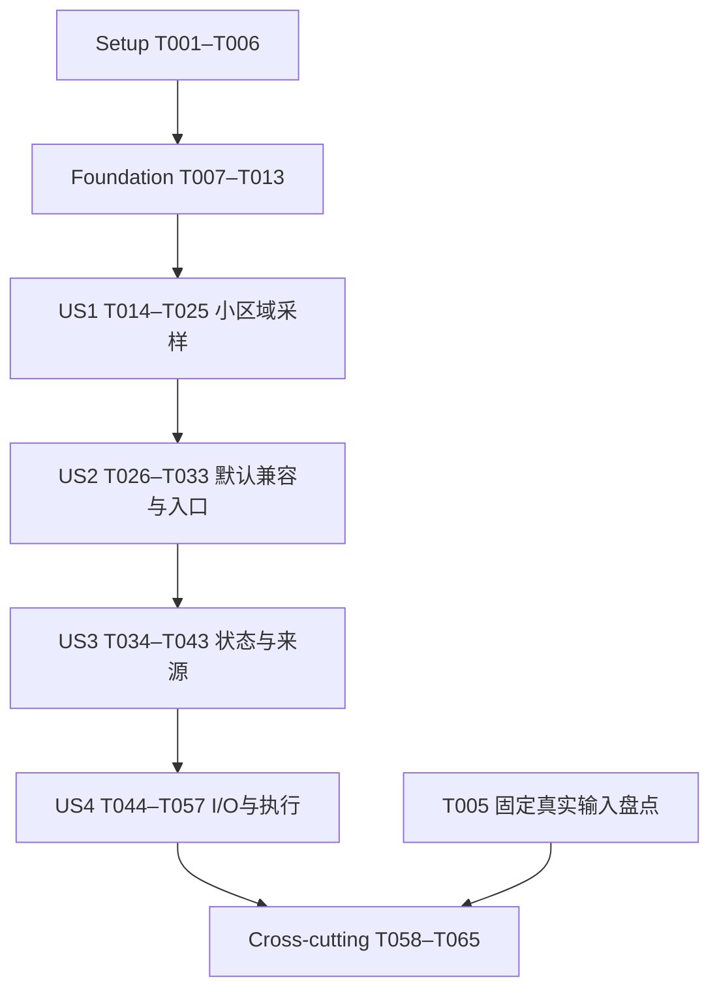

# Tasks: 统一区域入口的最近邻采样

**Input**: `specs/006-region-nearest-sampling/` 的 [spec.md](spec.md)、[plan.md](plan.md)、[research.md](research.md)、[data-model.md](data-model.md)、[contracts/](contracts/) 与 [quickstart.md](quickstart.md)。
**Created**: 2026-10-15
**Status**: 实施中；56/65 项已完成。任务勾选只表示该条目的实现/测试/说明工作有证据，不代表006整体或对应gate已通过。
**Tests**: spec 的 FR-015–019、SC-001–008 与计划 N0–N7 明确要求验证，因此包含数值、SQL/native、读取量、资源与独立复现任务；这些是行为验收，不是为文档改动补测试。
**Organization**: Setup → Foundational → US1/US2/US3（P1）→ US4（P2）→ 最终交付。每个故事可单独检查自己的增量；涉及共享扫描器时按真实依赖推进，不制造故事相互独立的假象。

## Format and execution rules

每项使用 `- [ ] TNNN [P?] [USn?] 描述与具体文件路径`。路径均相对仓库根目录；新文件明确写“新增”。Dependencies 是启动前置，不是完成证明；代码存在但必要检查失败时不能勾选。

- `[P]` 只标注在所列前置完成后可与配对任务独立编辑的工作；不授权启动额外代理。共享 `read_om.cpp`、projection、metrics、fixture generator 和构建文件保持单写入者。
- 优先写能捕获对应症状的失败用例，再改实现；初始不支持method/类型导致的失败与最终语义断言需分别记录，不能仅以绑定成功判通过。
- 不新增公共函数/单数别名，不实现bilinear、面积、Line、最近有效值搜索或缓存；默认/points必须保持005行为。
- 证据使用 `specs/006-region-nearest-sampling/evidence/` 下的新运行包；已归档包保持只读。包身份、输入与输出hash及命令退出码按[验收契约](contracts/validation-evidence.md)记录，缺输入标blocked而非pass。
- 不提交112MB原GFS文件或未知再分发条件的区界；使用可交付的来源记录/授权archive或调用者本地输入。T005完成来源盘点并新增了可复现的geoBoundaries ODbL替代几何；GFS固定输入的持久获取和再分发授权仍是T061/完整N5的前置。

## Phase 1: Setup — 冻结基线与验证设施

**Purpose**: 为代码修改建立独立基线、匹配依赖、可重生fixture和验收入口。

- [X] T001 冻结当前旧points的DESCRIBE、原值/NULL/om_source多重集合及值读取指标，以现有 `test/sql/regions.test`、`test/native/region_scan_test.cpp` 为输入，保存准确源码/产物身份和完整结果到新增 `specs/006-region-nearest-sampling/evidence/N0-points-baseline.md`；初始冻结时不使用尚未实现的method参数。最近重放修复了validator对线程环境的绑定，匹配捕获时 `threads=9`；行CSV与规范化metrics一致，说明旧points数据语义仍零差异。
- [X] T002 扩展 `scripts/fetch-region-runtime.py` 的nearest-only ST_PointOnSurface/ST_X/ST_Y准确签名、内点covers及实际extension_version探针，把三版本包/hash/probe保存到新增 `test/data/sampling/runtime-matrix.json`，不改写 `test/data/regions/runtime-matrix.json` 历史结果（依赖 T001）。
- [X] T003 [P] 在 `test/tools/duckomo_fixture_tool.cpp` 新增互斥 `--sampling-output DIR` 模式，生成 `test/data/sampling/` 下5×5、多变量/3非空间轴、交错/展平/负步长、状态及64²/256²同chunk内存对照OM和官方reader原值参考；保存生成输入/文件hash，避免调用生产locator（依赖 T001）。
- [X] T004 [P] 新增 `scripts/generate-sampling-reference.py`，按数值/验收契约独立生成标准WKB、解析矩形目标、binary64穷举及高精度距离参考、独立轴/点序和预期状态；定义 `--output test/data/sampling` 及自检，输出 `test/data/sampling/manifest.json`，与T003按约定文件分工且不覆盖OM原值CSV（依赖 T001）。
- [X] T005 [P] 新增 `test/data/sampling/real-inputs.json`，盘点既有东城区52顶点几何与2026-10-14 GFS的来源声明、长度/hash、本地或授权archive获取与导出流程；记录未知datum/区界版本及可再分发条件，不错归GADM、无输入不换日期；输出可取得或blocked的具体原因（依赖 T001）。
- [X] T006 在 `CMakeLists.txt`、`test/CMakeLists.txt`、`Makefile`、`scripts/validate.sh` 登记locator/region_sampling native和SQL测试及源文件，区分不需spatial与需匹配spatial的执行/跳过策略；完善T003/T004重生及hash核对，让缺工具/包不算通过（依赖 T002、T003、T004）。

**Checkpoint**: 旧行为与依赖身份已保存，合成数据及参考可在无网络环境重复生成。真实输入缺口不隐瞒，但不阻塞后续合成能力实现。

## Phase 2: Foundational — 位置、数值与布局基础

**Purpose**: 所有故事的共享前置；完成后才接入nearest SQL扫描。

- [X] T007 新增 `test/native/nearest_sampling_test.cpp` 的失败用例，加载T004独立参考，覆盖源点/四点平局/近等距/极点/对跖附近/轴最近反例/周期/区域unwrapped域/负步长/两种展平序/拒绝能力；分别断言源index与数值误差，保留失败证据（依赖 T006）。最近加强native oracle断言：三版都要求61个非空reference、10个exact-tie、至少20个between-cell目标、恰好一个独立逐轴最近点2而球面最近点0的反例；scientific reference固定3 ordinary/3 singular分类。当前N1报告记录声明范围内的有限能力矩阵与科学参考均已复核并通过，同时保留不声称任意binary64穷尽的边界。
- [X] T008 在新增 `src/include/duckomo/nearest_sampling.hpp`、`src/include/duckomo/region_sampling.hpp` 定义纯定位输入/候选/capability、RegionMethod/Options、GeometryStatus、immutable NearestPlan和非空间任务边界；不注册公共factory，不重复定义既有来源结构（依赖 T007）。代码与locator测试覆盖均完成；N1三版本声明范围的最终证据见 [`n1-n2-acceptance-refresh-20261019-final-7`](evidence/n1-n2-acceptance-refresh-20261019-final-7/)。
- [X] T009 在新增 `src/grid/nearest_sampling.cpp` 实现流式逐轴资格检查、球体/有限/唯一性校验、精确周期条件、原始unwrapped target lift与闭域判断；不扩大半格，不用归一化min/max填补seam，拒绝不支持grid/model（依赖 T008）。
- [X] T010 在 `src/grid/nearest_sampling.cpp` 实现sphere_haversine_f64_v1、精确落点/源极点分支、distance_m与point_index排序及可取消全坐标流式locator，在 `CMakeLists.txt` 固定无fast-math/FMA contraction；每区域一次定位，不物化全域坐标、不做未证明剪枝（依赖 T009）。
- [X] T011 扩展 `src/grid/spatial_layout.cpp`、`src/include/duckomo/spatial_layout.hpp` 及 `test/native/spatial_layout_test.cpp`，由真实非空间indices和源x/y反建完整axis_indices/logical_index，检查stride乘加与shape上界，验证lat_fastest/分离轴/交错轴点身份不变（依赖 T008）。
- [X] T012 在新增 `src/scan/region_sampling.cpp` 实现RegionSamplingOptions严格解析和可单测的NearestAxisCursor/结果上界计算，复用 `src/scan/axis_selection.cpp` 的安全轴选择逻辑但不枚举空间shape；实现无源行的语义轴indices生成和受检溢出（依赖 T010、T011）。
- [X] T013 运行 `test/native/nearest_sampling_test.cpp`、布局与cursor检查及独立参考重生，核对普通距离误差、近极点/对跖预定界和阈值nextafter/tie，保存N1结果与工具链/flags到新增 `specs/006-region-nearest-sampling/evidence/N1-locator.md`；失败先修定位，不放宽源index比较（依赖 T010、T011、T012）。

**Checkpoint**: N1声明范围内的合成定位/布局与GFS025 profile验收通过；内部策略/状态定义在本阶段完成，US1的nearest SQL端到端接入由后续任务实现。

## Phase 3: User Story 1 — 在同一个区域入口取得小区域代表值 (Priority: P1)

**Goal**: 通过现有read_om_regions的nearest，为有效域内区域返回可核对的代表值，保留多变量及非空间轴。
**Independent Test**: Gap polygon在默认方式零行，nearest每区域×member/time/level组合恰好一行，源在面外且源值/位置与独立读取一致；两个区域共享source仍各自输出。

### Tests for User Story 1

- [X] T014 [P] [US1] 新增 `test/sql/region_sampling.test` 的nearest schema、Gap/同source多区域、多变量与3非空间轴/重复标签的失败场景，核对原变量FLOAT、目标lat/lon与源坐标、原始轴位置和双向EXCEPT ALL参考（依赖 T013）。
- [X] T015 [P] [US1] 新增 `test/native/region_sampling_test.cpp` 的域内正常采样/直接源读取/多批次任务用例，先证明未实现路径失败，使用T003官方值参考和T004位置oracle，不重用SQL测试中的待测结果作expected（依赖 T013）。

### Implementation for User Story 1

- [X] T016 [US1] 扩展 `src/scan/region_geometry.cpp`、`src/include/duckomo/region_geometry.hpp` 的nearest-only公开函数adapter，绑定内点/X/Y、验证finite与ST_Covers、记录实际spatial_version；points仍只要求原有签名，不读私有GEOMETRY布局（依赖 T014、T015）。
- [X] T017 [US1] 在 `src/scan/region_sampling.cpp` 构造完整区域NearestPlan，复用RegionCollection校验/ID顺序，逐区域生成目标和空间候选、共享方法/grid/layout身份并在8MiB容量内冻结，所有区域在输出前验证（依赖 T016）。
- [X] T018 [US1] 在 `src/scan/read_om.cpp` 的既有区域factory/binder注册method、max_distance_m、out_of_bounds并接T012/T017，构建region_id后/om_source前的sampling准确类型，保留原变量名/FLOAT和include_source开关；不注册新函数（依赖 T017）。
- [X] T019 [US1] 在 `src/scan/read_om.cpp` 的global/local状态和 `src/scan/region_sampling.cpp` 接入nearest-only非空间任务领取，使用短锁/单task单region/有限批次，输出语义轴由原轴indices确定，不经过points源点covers过滤（依赖 T018）。
- [X] T020 [US1] 在 `src/scan/read_om.cpp` 接入有效源logical index的批内sort/unique、BuildSelectedBatchSegments、原DecodeSelection与scatter，重复source不丢结果、NaN按原reader转NULL、所有数组成功后提交chunk cardinality（依赖 T019）。三版本官方reader native parity、重复来源、NaN/source身份与partial-chunk错误恢复见N2运行包和US1/US3证据。
- [X] T021 [US1] 在 `src/scan/projection.cpp`、`src/include/duckomo/projection.hpp` 和 `src/scan/read_om.cpp` 增加sampling完整STRUCT输出槽及域内逐变量状态，建立真实状态变量依赖；暂按完整STRUCT保守读取，字段级优化由US4完成，不用假NULL填未读状态（依赖 T020）。
- [X] T022 [US1] 在 `src/scan/read_om.cpp` 输出代表lat/lon、sampling源坐标/point index/距离/nonspatial indices及真实om_source.logical_index，源值缺测仍保留来源；核对两个区域共享source时不合并ID（依赖 T021）。
- [X] T023 [US1] 在 `src/scan/read_om.cpp` 将ObserveComplexFilter按method分流，nearest仅提取非空间轴安全条件，lat/lon与值保留最终residual；不把polygon bbox或target坐标筛选传给source选择（依赖 T022）。三版本双向EXCEPT ALL过滤等价、目标/值residual及投影依赖在N2/N3 SQL矩阵通过，证据见N2-sql-matrix.md与N3-io.md。
- [X] T024 [US1] 完成 `test/sql/region_sampling.test`、`test/native/region_sampling_test.cpp` 的合成域内端到端验证，包含空间轴前/中/后的排列、未映射轴、无非空间轴、非空间游标跨批，以及完整多重集和直接值/source parity (依赖 T023)。
- [X] T025 [US1] 保存US1域内采样检查与point/target/value/source/axis完整对照到新增 `specs/006-region-nearest-sampling/evidence/US1-core.md`，记录T005真实输入可用性；本checkpoint只证明合成核心，不把真实东城区N5或未完成状态/资源验证标pass（依赖 T024）。

**Checkpoint**: 本地合成域的小多边形代表值可查询并解释，US1 core 有三版本 runtime / official-reader 对照。N1/N2按声明范围通过；N5子检查见其证据、完整N5授权/归档与gate包及N6/N7仍未完成。

## Phase 4: User Story 2 — 保持现有查询习惯并说明入口 (Priority: P1)

**Goal**: 默认行为与005一致，仅通过method切换，并给出清楚入口选择说明。
**Independent Test**: 省略method与显式points的DESCRIBE、来源/原值/NULL多重集合零差异；nearest沿原变量名；未知/NULL方法与不适用参数拒绝。

### Tests for User Story 2

- [X] T026 [P] [US2] 在 `test/sql/regions.test` 增加省略method/显式points的schema和双向EXCEPT ALL兼容检查，覆盖边界/洞/MultiPolygon/Gap/Empty/Outside及include_source，保留T001旧构建基线对照（依赖 T025）。
- [X] T027 [P] [US2] 在 `test/sql/regions_spatial_dependency.test`、`test/native/region_geometry_test.cpp` 增加普通read_om不需spatial、points不增加内点函数依赖，以及nearest缺失/错误签名拒绝的独立进程检查（依赖 T025）。

### Implementation for User Story 2

- [X] T028 [US2] 在 `src/scan/region_sampling.cpp`、`src/scan/read_om.cpp` 完整落实method的ANY实际类型检查和大小写精确枚举，拒绝NULL/数字/bilinear/未知参数以及points显式携带nearest-only选项，非法输入不被WHERE/LIMIT隐藏（依赖 T026、T027）。
- [X] T029 [US2] 审核并修复 `src/scan/read_om.cpp`、`src/scan/projection.cpp` 的points默认分支/schema顺序/虚拟列/旧保留名集合，确保sampling只在nearest冲突、read_om/raw/grid_info参数不扩展且无新SQLfactory（依赖 T028）。
- [X] T030 [US2] 将method/options/完整区域计划与内容身份纳入 `src/scan/read_om.cpp` 的ReadOmBindData Copy/Equals/owned计量，保留SupportStatementCache=false，并在 `test/sql/region_sampling.test` 验证getvariable/PREPARE重绑定、方法切换schema及区域快照无陈旧复用（依赖 T029）。
- [X] T031 [P] [US2] 更新 `docs/spec.md`、`README.md`、`README.en.md` 的入口选择与最小示例：文件/矩形范围用read_om，polygon用read_om_regions；method省略/points与nearest对照，明确代表值不是面积均值，不写未实现bilinear（依赖 T030）。
- [X] T032 [P] [US2] 在 `test/sql/region_sampling.test` 完善函数目录数量/原变量名/FLOAT/nearest schema与sampling冲突的断言，确保没有单数别名或新增采样入口、无关投影不能绕过名称错误（依赖 T030）。
- [X] T033 [US2] 运行旧005与新增兼容/参数/依赖/重绑定检查，对照T001基线保存到新增 `specs/006-region-nearest-sampling/evidence/US2-compatibility.md`；只有差异为零且准确拒绝矩阵全过才标该故事完成（依赖 T031、T032）。

**Checkpoint**: 用户无需多学一个函数；旧查询行为保持，入口文档能直接指导选择。

## Phase 5: User Story 3 — 解释空值、距离与实际来源 (Priority: P1)

**Goal**: EMPTY、域外、距离超限和逐变量缺测有明确结果/来源规则。
**Independent Test**: 固定状态矩阵每个区域×原轴组合行数正确；源缺测不换点；超距保留候选却无成功om_source；EMPTY/域外没有候选。

### Tests for User Story 3

- [X] T034 [P] [US3] 在 `test/sql/region_sampling.test` 增加EMPTY/域外默认与error/距离0及内等外/NULL与非有限值/多变量混合缺测失败场景，核对完整sampling MAP、计数和om_source；精确阈值使用distance与nextafter参考而非打印截断（依赖 T033）。
- [X] T035 [P] [US3] 在 `test/native/region_sampling_test.cpp` 增加全无source批次、无非空间轴、3非空间轴、重复标签、源值±Inf和异常输入全集校验的用例，确保中间空源批次仍产出结果而非EOF（依赖 T033）。现有 `TestNearestStatusAndNonfiniteValues` 以 EMPTY、Outside、后续 Gap 证明空source行不提前EOF，并核对±Inf；`TestNearestScanParity` 覆盖无非空间轴、3轴、重复标签/原始位置；选项与 SQL 绑定矩阵拒绝异常输入。当前 v1.5.4 native suite 通过。

### Implementation for User Story 3

- [X] T036 [US3] 在 `src/scan/region_sampling.cpp`、`src/scan/read_om.cpp` 完成EMPTY与outside_domain计划状态，严格out_of_bounds=error在全集绑定阶段失败；无源结果仍按非空间cursor输出真实语义轴，禁止捏造source index 0（依赖 T034、T035）。SQL/native 矩阵验证 EMPTY、域外各保留12个轴组合行、真实轴索引及无候选/无来源字段；strict 域外错误在 WHERE/LIMIT 0 下仍失败，见 US3-states 与本轮 N2 输出。
- [X] T037 [US3] 在 `src/scan/region_sampling.cpp` 完成max_distance_m类型/finite/非负检查和<=比较，超限保留候选坐标/距离、几何状态beyond_max_distance、采样source_count为0，距离等于上限允许（依赖 T036）。精确阈值、上方/下方 `nextafter` 与0距离精确源点均有 SQL 断言；超距保留候选而不发布成功源。
- [X] T038 [US3] 在 `src/scan/read_om.cpp` 实现完整逐变量status/source_count/valid_source_count输出，几何ok时NaN→source_null而来源不变、其它有效变量保持ok；几何失败时值NULL且变量状态继承几何状态、不读值、不查更远点（依赖 T037）。SQL/native 覆盖 EMPTY、域外、超距、selected NaN、混合变量及±Inf；逐变量计数由 native metrics 复核。
- [X] T039 [US3] 在 `src/scan/read_om.cpp` 修正所有状态下target/source/om_source的NULL有效性及partial chunk提交，严格真实成功源身份；测试源缺测保留来源、超距只有候选、EMPTY/域外无候选（依赖 T038）。US3 SQL 行级矩阵核对 target、candidate、om_source NULL 有效性和 source 身份；早停/失败时不发布 exact result count。
- [X] T040 [US3] 在 `test/native/region_sampling_test.cpp` 补齐权限、短读、损坏解码与对象变化错误不会变source_null的断言，并核对LIMIT/WHERE不隐藏非法区域或strict域外（依赖 T039）。短读、decoder corruption、对象变化、权限撤销均要求真实 I/O 错误而非 `source_null`，并检查同连接恢复；SQL 覆盖strict 域外被 WHERE/LIMIT 隐藏时仍失败。
- [X] T041 [US3] 执行 `test/sql/region_sampling.test` 与 `test/native/region_sampling_test.cpp` 的全状态/空集合/非法参数矩阵，验证所有轴组合行数与来源/value对照；失败保持任务未完成（依赖 T040）。刷新后三版本 N2 SQL/native 命令退出码均为0；N2按声明范围通过，验收包见 `evidence/n1-n2-acceptance-refresh-20261019-final-7/`。
- [X] T042 [P] [US3] 在 `specs/006-region-nearest-sampling/quickstart.md` 与 `docs/spec.md` 按实际实现更新状态辨别、COUNT语义、nearest目标与源坐标示例，去掉已实现部分的规划占位但不夸大其它方法（依赖 T041）。文档包含目标与源坐标、COUNT结果行语义、EMPTY/域外/超距/缺测辨别及nearest-only能力范围。
- [X] T043 [P] [US3] 将状态矩阵的完整SQL/output/hash与解释写到新增 `specs/006-region-nearest-sampling/evidence/US3-states.md`，逐项核对FR-006–014和SC-004，单列几何与变量状态（依赖 T041）。状态行、参考输入hash、SQL/native身份、三版本运行包与逐状态限制已记录；N2声明范围内的SQL/native profile已通过；真实输入SC-004与N6仍未完成。

**Checkpoint**: 本地合成profile的状态、阈值、缺测与来源语义已实现并有测试；N2按声明范围通过，N5完整gate与N6审计仍未完成。

## Phase 6: User Story 4 — 正确局部读取与执行可靠性 (Priority: P2)

**Goal**: 只读计算所需值，完整WHERE、投影依赖、线程、内存与恢复有实证。
**Independent Test**: 几何leaf与COUNT零值I/O；值/MAP状态依赖真实；源在polygon外不丢；16×空间增长工作峰≤2×；不同线程/来源多重集合一致。

### Tests for User Story 4

- [X] T044 [P] [US4] 在 `test/sql/region_sampling.test` 增加COUNT/target/source/sampling几何leaf与整STRUCT/MAP/value/filter的投影组合，检查零值index/data/decode及保守全部绑定状态依赖，覆盖重复投影和variable限定（依赖 T042、T043）。v1.5.4–v1.5.6 每版176 assertions通过；SQL检查COUNT/几何leaf零值I/O、完整STRUCT全变量读取、变量限定MAP和重复status leaf，native ledger补充直接值列和数据字节/decode基线；详见US4-projection.md。
- [X] T045 [P] [US4] 在 `test/native/region_sampling_test.cpp` 增加2048边界与缩批、1/2/4worker多重集、16×空间内存、checked overflow、取消/早停/短读/损坏/对象变更后恢复的失败用例，分别观察结果与完整性而非只查不崩溃（依赖 T042、T043）。当前实现单task最多2048个非空间结果，并受scratch预算缩批；2049轴行 fixture 断言value/status-map结果完整且 `sampling.max_task_rows=2048`，额外行由第二task完成。四区域并发矩阵验证1/2/4 worker fingerprint；既有用例覆盖16×空间内存、checked signed-64边界、LIMIT/cancel/短读/损坏/对象变更及同连接恢复。三版本 runtime 的 N4 worker/lifecycle 命令及隔离内存运行均通过，见归档manifest；不代表N5远程验收完成。

### Implementation for User Story 4

- [X] T046 [US4] 在 `src/scan/projection.cpp`、`src/include/duckomo/projection.hpp` 和 `src/scan/read_om.cpp` 接收完整ColumnIndex，增加FULL_READ/PUSHDOWN_EXTRACT叶输出类型与nearest-only supports_pushdown_extract，准确输出宿主期待的leaf vector，旧points/read_om保持原行为（依赖 T044、T045）。v1.5.4–v1.5.6均通过sampling SQL/native；测试覆盖嵌套leaf类型与值、FULL_READ 15子字段STRUCT、points兼容与直接值槽，见US4-projection.md。
- [X] T047 [US4] 在 `src/scan/projection.cpp`、`src/scan/read_om.cpp` 实现几何leaf无值依赖、variables MAP/完整sampling依赖全部绑定变量、直接值列/过滤依赖去重；未知/full-read保守计算真实状态，必要三版本差异仅封装到 `src/compat/duckdb_api.cpp` 和 `src/include/duckomo/compat/duckdb_api.hpp`（依赖 T046）。三版本 native I/O账本与SQL矩阵验证几何/COUNT零值读、MAP/full STRUCT读取全部变量、限定MAP/直接列仅读指定值数组；target/value residual与完整采样后过滤多重集一致，重复status leaf不新增值依赖。
- [X] T048 [US4] 在 `src/scan/read_om.cpp` 验证并修正method-aware轴必要条件与完整residual，针对target lat/lon、源在面外、值/状态过滤做与完整采样后筛选的双向差分；不得通过先筛源值改变nearest（依赖 T047）。v1.5.4–v1.5.6 SQL过滤矩阵通过，并以完整nearest materialized后过滤的双向EXCEPT ALL核对target和值条件；三版native projection/filter suite通过。
- [X] T049 [US4] 在 `src/include/duckomo/metrics.hpp`、`src/scan/read_om.cpp` 增加sampling identity/region_axis_result/定位CPU/结果与源读取/状态依赖字段，points旧单位不变；nearest旧regions执行指标用NULL及applicable=false，exact只在完整结束发布（依赖 T048）。N4隔离执行新增对 locator CPU 实测字段的采集，N0/N4续跑确认完整与早停计数断言；N3/N4完整门状态另见各 evidence。
- [X] T050 [US4] 在 `src/scan/region_sampling.cpp`、`src/scan/read_om.cpp` 接入plan≤8MiB/global≤8MiB/新增worker scratch≤512KiB和动态批次容量账本，reader/decoder/输出/第三方分别计量，每≤256项检查取消且task只结算一次，不预建region×axis任务表（依赖 T049）。N4六个独立进程测量验证64²→256²时query-owned上界1.40×、worker work peak 1.00×，三版皆低于2×且scratch≤512KiB；测量记录和输出hash见 [`run-20261017-sampling-validation-final/manifest.json`](evidence/run-20261017-sampling-validation-final/manifest.json)。
- [X] T051 [P] [US4] 新增 `scripts/validate-sampling.py` 的N0–N4执行器，按契约参数连接真实native/SQL检查、完整值基准/局部读取、16×资源实验和新目录证据；区别pass/fail/blocked/not-run，--self-check不冒充验收，记录脱敏命令/身份/hash（依赖 T050）。N0 replay固定runtime矩阵记录的 `threads=9`、`duckomo_max_threads=9`，冻结输入只读；N4运行64²/256²隔离进程并记录work upper bound、CPU、reader指标；最新注册运行包为 [`run-20261017-sampling-validation-final`](evidence/run-20261017-sampling-validation-final/)，N0/N3/N4 pass、N1/N2当时blocked、N5–N7当时not-run；2026-10-19 scoped refresh后N1/N2按声明范围通过，历史包不变。受控远程/真实输入门仍未完成。
- [X] T052 [P] [US4] 新增 `test/tools/sampling_evidence_test.py`，用临时伪证据包验证参数/输入缺失/identity错配/失败或早停exact计数/未知transport/自检与运行区分等拒绝契约；不依赖T051正在写的实现才能生成expected（依赖 T050）。隔离内存唯一记录/尺寸匹配/缺失/重复拒绝及 runtime identity、gate parser 等共9 tests pass。
- [X] T053 [US4] 完成 `scripts/validate-sampling.py`、`test/tools/sampling_evidence_test.py` 的集成自检和真实N0–N4执行，确保validator退出码/结论与测试一致，修复伪成功与未实现gate误报（依赖 T051、T052）。自检输出 `self-check-only`；历史完整包记录 N0/N3/N4 pass、N1/N2当时blocked、N5–N7当时not-run；2026-10-19刷新后N1/N2按声明范围pass，历史包保持不变；同时修复 sanitizer 注册身份检查并验证 N4 运行成功。
- [X] T054 [US4] 更新 `test/CMakeLists.txt`、`scripts/validate.sh`、`Makefile` 让有spatial的sampling native/SQL与sanitizer真正执行，分别核对普通make test跳过理由和region-validation覆盖清单，不能仅登记源文件（依赖 T053）。sampling-validation 目标配置所选 spatial 的路径/hash、构建 sampling bundle 与 sanitizer 并调用采样验证器；普通 test 仍按 region-validation 既有规则跳过需要 spatial 的区域 SQL/native。`make -n` 核对三目标命令，实际入口生成的运行包含 SQL/native/sanitizer 命令记录。
- [X] T055 [US4] 在匹配runtime运行N3完整投影/filter/I/O矩阵，完整消费固定可跳块对象同变量的全值baseline与nearest；保存数据字节/解码严格下降、几何leaf零值成本及fallback说明到新增 `specs/006-region-nearest-sampling/evidence/N3-io.md`（依赖 T054）。本轮三个匹配 runtime 的 SQL/native projection/filter/full-read 矩阵通过；geometry/COUNT为0值index/data/decode，same-object nearest 224 B/1 chunk 对 full 15,449,547 B/66,432 chunks；gate manifest 为 N3 pass。
- [X] T056 [US4] 运行N4的1/2/4线程、64²/256²同chunk内存对照、取消/失败/早停恢复及sampling ASan/UBSan，保存完整ledger/峰值比/不完整exact=NULL到新增 `specs/006-region-nearest-sampling/evidence/N4-resources.md`；不把CPU线性增长冒充内存问题或隐藏reader容量（依赖 T055）。三版本 worker/task/failure-recovery 矩阵、六个独立进程内存测量和 v1.5.4 匹配 spatial ASan/UBSan 均通过，64²→256² owned bound 1.40×、worker peak 1.00×；N4 本地 gate pass。受控远程与N5/N6范围不由此完成。
- [X] T057 [US4] 实现并运行注册N5受控HTTP/HTTPS/签名S3合成与真实输入差分、拒绝/恢复；三版本60条命令通过，凭据仅私有stdin，服务日志脱敏，见 `evidence/N5-remote.md` 和 `evidence/private-n0-n5-final/`。

**Checkpoint**: N1/N2合成规则网格与GFS025声明范围、投影/I/O (N3)、资源/lifecycle (N4) 有注册通过证据。N5真实数据及受控传输子检查已有结果，但原始数据授权/持久归档与独立N5 gate包未完成；N6/N7未完成。

## Phase 7: Polish & Cross-Cutting — 真实案例、三版本和交付

**Purpose**: 完成跨故事验收与用户交付。此阶段没有US标签，所有实现范围仍限006。

- [X] T058 扩展 `scripts/validate-sampling.py` 的N5真实输入与N6/N7证据接口，核对文件长度/hash、几何导出及来源记录、三版本artifact/source/query/output绑定、独立执行者类型；输出新目录，缺真实输入/包/远程子场景时明确partial/blocked，不覆盖历史证据（依赖 T057、T005）。
- [X] T059 在 `test/tools/sampling_evidence_test.py` 增加N5/N6/N7完整与缺失输入/许可来源声明/错误日期/混用产物/仅本地N5/仅self-check的负例，核对高精度与兼容oracle分开、执行后改expected被识别，并运行审计测试（依赖 T058）。
- [X] T060 更新 `docs/architecture.md`、`README.md`、`README.en.md`、`docs/spec.md` 与 `specs/006-region-nearest-sampling/quickstart.md` 对照实际实现/运行命令，解释CPU定位与局部值I/O、目标/源/COUNT/状态及支持网格；所有未来方法仍标未支持（依赖 T059）。
- [X] T061 固定geoBoundaries 2017东城区与哈希匹配GFS，在三个版本验证points零行、nearest源(116.50,40.00)、原值/NULL及来源与直接读取一致。用户确认内部验证/私有留存及授权访问，禁止公开分发；仓库外私有归档与取回hash已验证。见 `evidence/N5-private-use-decision.md`、`evidence/N5-remote.md`。
- [X] T062 Linux AArch64三个版本当前源码产物重建并核验，N0–N5完整运行通过；实际build位置、源码摘要及逐产物hash在当前包inputs/build manifests，见 `evidence/version-matrix.md`。
- [X] T063 N6审计当前三版本N0–N5通过状态、实际命令、完整传输库存、SQL/output/产物hash及私有归档取回；缺失/篡改拒绝测试通过。见 `evidence/N6-audit.md` 和 `evidence/private-n6-final/`。
- [X] T064 由未参与实现的执行者按 `specs/006-region-nearest-sampling/quickstart.md` 复现入口选择、points/nearest切换、空值/域外与实际源核对，运行N7并保存完整输入/命令/输出/执行者类型到新增 `specs/006-region-nearest-sampling/evidence/N7-independent.md`；若独立执行者未安排则保持未完成（依赖 T063）。
- [X] T065 根据N0–N7真实结果更新 `specs/006-region-nearest-sampling/evidence/final.md`、`docs/roadmap.md`、本 `specs/006-region-nearest-sampling/tasks.md` 的状态与残余限制，记录源码与最终产物身份，确认无新增函数/未来算子/历史证据改写；仅在全部必要gate通过后报告006完成（依赖 T064）。当前 `evidence/final.md` 是未验收状态快照，不关闭T065；N5 gate、N6审计与满足契约的N7仍未完成。

## Dependencies & Execution Order

### Phase / story graph

US1域内核心可在不依赖US3全状态和US4优化时独立验证，但不能据此发布完整006。US2测试先编写兼容基线，修复时依赖US1已有的method/binder；US3依赖稳定schema与绑定；US4依赖状态准确后再裁剪其读取依赖。共享文件使这些故事的主实现串行，测试/文档可按下面的小批次并行。

### Task edges and single-writer boundaries

每条任务已列启动依赖；未标依赖的T001是根任务。Phase 2整体完成是故事的前置。并行标记只在下表批次使用，后续修改同一路径的任务必须等前一任务完成：

| 前置已完成 | 可并行任务 | 写入互斥边界 |
| --- | --- | --- |
| T001 | T002、T003、T004、T005 | runtime探针、fixture C++、独立Python/WKB/manifest、真实输入盘点分别写不同文件；T003/T004遵守OM/CSV与WKB/参考文件分工 |
| T013 | T014、T015 | SQL测试与native测试分离；CMake登记已在T006，不并发改共享构建文件 |
| T025 | T026、T027 | regions.test与依赖隔离/native geometry文件分离 |
| T030 | T031、T032 | 产品文档与region_sampling.test分离 |
| T033 | T034、T035 | SQL状态与native状态用例分离 |
| T041 | T042、T043 | 教学文档与证据报告分离 |
| T042、T043 | T044、T045 | SQL I/O与native资源用例分离 |
| T050 | T051、T052 | validator与独立拒绝矩阵测试分离；测试期望来自契约，不读取半成品实现 |

T011虽与定位数值实现文件不同，仍保持默认串行基线；可在明确独占文件和T008类型冻结后调整，但本任务表不自动给同一工作区多写入者授权。N5外部输入、受控服务或独立执行者阻塞时可继续无依赖任务，不能越过依赖宣称gate完成。

## Parallel Examples by User Story

以下是任务调度示例，不是shell命令，也不表示本次已启动代理。

| 故事 | 同时准备的工作 | 汇合点 |
| --- | --- | --- |
| US1 | T014 SQL schema/多重集用例；T015 native直接源读取用例 | T016开始adapter实现前两者失败信号已确认 |
| US2 | T026旧points差分；T027spatial依赖隔离；后续T031文档与T032目录/schema断言 | T028完整参数策略、T033兼容验收 |
| US3 | T034 SQL状态矩阵；T035 native无源结果用例；后续T042教学与T043证据 | T036状态路径、T041完整矩阵 |
| US4 | T044字段投影成本；T045资源/线程用例；后续T051验证器与T052独立拒绝测试 | T046接投影、T053执行器集成 |

## Requirement and gate traceability

| spec范围 | 主要实施/验证任务 | gate |
| --- | --- | --- |
| FR-001、FR-002：单入口与默认兼容 | T001、T018、T026–T033 | N0、N2 |
| FR-003：面内代表位置 | T002、T016、T017、T024 | N0、N2 |
| FR-004、FR-005：球面最近与平局 | T004、T007–T010、T013 | N1 |
| FR-006、FR-007：覆盖与距离 | T009、T012、T034–T037、T041 | N1、N2 |
| FR-008：缺测不换点 | T020–T022、T034、T038、T041 | N2 |
| FR-009、FR-010：轴/多变量/原名 | T003、T011、T012、T014、T019–T024、T032 | N2 |
| FR-011、FR-012：详情与来源 | T018、T021、T022、T035、T039、T041、T046–T047 | N2、N3 |
| FR-013、FR-014：状态与整体校验 | T017、T028–T030、T034–T041 | N0、N2 |
| FR-015、FR-016：完整WHERE与投影依赖 | T023、T044、T046–T048、T055 | N3 |
| FR-017：有限源读取/实际成本 | T020、T051、T053–T055 | N3 |
| FR-018：有界/取消/终态 | T012、T019、T030、T045、T049–T050、T056 | N4 |
| FR-019：远程/线程一致 | T045、T056–T057、T062 | N4、N5、N6 |
| FR-020：入口/解释与指南 | T031、T042、T060、T064 | N7 |
| SC-001：真实东城区 | T005、T058、T061–T063 | N5、N6 |
| SC-002：独立数值参考 | T004、T007–T013、T059、T062–T063 | N1、N6 |
| SC-003：旧行为零差异 | T001、T026–T033、T062 | N0、N2、N6 |
| SC-004：状态矩阵 | T034–T043、T059、T062 | N2、N6 |
| SC-005：多轴/线程/来源 | T014–T025、T045、T056–T057、T062 | N2、N4、N5 |
| SC-006：零值I/O与局部收益 | T044、T046–T048、T055 | N3 |
| SC-007：16×内存与恢复 | T003、T045、T049–T050、T056 | N4 |
| SC-008：独立复现 | T060、T064 | N7 |

N0–N5逐gate证据由执行器记录，N6核对包完整性，N7独立执行；任何部分通过不提升未执行gate状态。N5真实与远程子场景都完成才能整体通过，不要求真实112MB公网全域收益扫描。

## Implementation Strategy

### MVP first

先完成T001–T025：提供可在合成粗网格上演示的小区域nearest核心与直接来源对照。T005真实输入问题提前浮现。MVP是内部可验证增量，默认兼容基线必须持续回归；不会以MVP替代US2/US3/US4或spec完整验收。

### Incremental delivery

随后按US2→US3→US4推进：稳定旧查询/入口说明，完善NULL/阈值/来源，再做字段级读取与资源/远程可靠性。每个故事checkpoint核对自己的独立场景，已通过的早期回归随共享路径修改重跑。

### Completion boundary

最后处理T058–T065的真实案例、三版本证据审计和独立复现。N0–N4各自声明范围内通过；N1/N2 scoped refresh独立保存。N5真实数据与三版本受控传输子检查已有记录，但N5独立gate包、原始数据授权/持久归档与N6完整审计仍未完成；现有N7本地复现由实现worker执行，不满足独立执行者要求。本文件只将有可核验实现与运行证据的条目标为完成，未验证门保持未完成。

## Task counts and validation

当前checkbox快照：56/65 项完成，US3 的本地合成状态与来源矩阵完成，US4 的本地投影/I/O和资源生命周期范围完成；N1/N2按声明范围通过；N5部分子检查有证据，但其gate与N6未完成；N7本地复现不满足独立执行者要求。完整状态见[evidence/final.md](evidence/final.md)。任务完成只适用于条目所列实现、测试或文档范围，不提升 story 的整体gate状态。

| 分类 | 数量 |
| --- | ---: |
| Setup | 6 |
| Foundational | 7 |
| US1 / P1 | 12 |
| US2 / P1 | 8 |
| US3 / P1 | 10 |
| US4 / P2 | 14 |
| Polish / Cross-cutting | 8 |
| **合计** | **65** |

所有任务须通过复核：连续唯一ID、空checkbox、故事阶段准确US标签、具体路径、依赖无环/无前向启动、并行批次写入不冲突、20条FR与8项SC均有实施和验收映射。`[P]` 项共17项；T002虽未标P也可在T001后与不同路径的Setup工作并行，具体如依赖表。checkbox表示该任务的具体范围已完成；story/gate的整体接受状态见各 evidence 报告，不能由若干已完成任务推断。

## Subsequent private-scope N5/N6 completion

Owner authorized internal validation/private retention and authorized access, with no public redistribution. The current N0–N5 run and separate N6 audit pass; T057/T061/T062/T063 are now complete (60/65 total). Earlier 56/65 checkpoint text above is historical. T058/T059 remain partial because they also require formal N7 interfaces/rejection tests; T060/T064/T065 remain open. Overall 006 is not accepted until the remaining independent evidence and final reconciliation are complete.

## Independent human N7 completion

T064 is complete: the human user ran scripts/run-n7-manual.sh in a fresh matching v1.5.5 process; complete identities/SQL/output/exit/hash evidence is retained in evidence/n7-human-verified/. All assertions pass. Current completion is 61/65; formal N7 validator interfaces/negative checks in T058/T059 and final reconciliation T060/T065 remain open.

## Final delivery reconciliation

65/65 tasks complete for the declared scope. N7 formal interface validates retained human/fresh-process/exit/SQL/output/runtime identities; negative tests reject worker execution, missing assertions, altered files, wrong artifacts and incomplete inventory. N0–N6 runtime snapshots are unchanged; final follow-up edits are validation tooling and docs. README, architecture, interface, roadmap and this final state are reconciled. Earlier partial checkpoint statements above are historical. No new public sampling function or future operator was added, and no historical execution package was rewritten.
